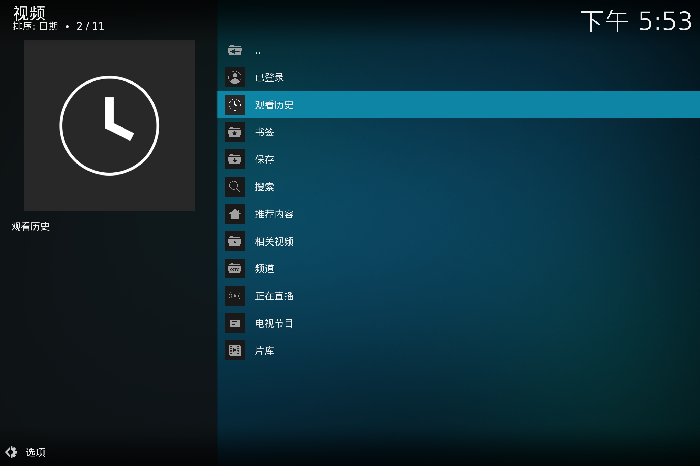
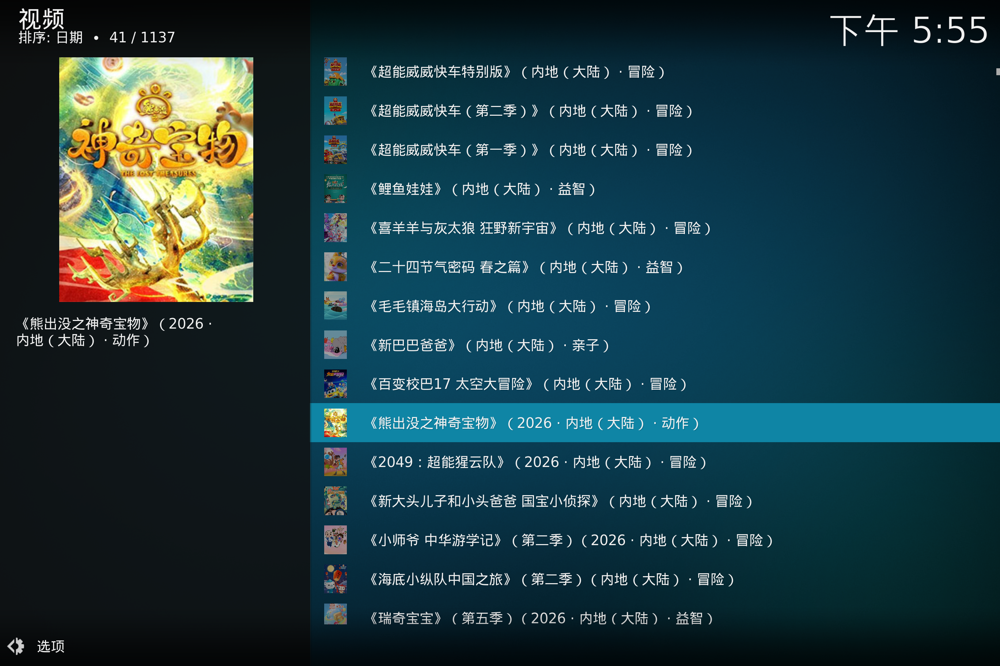
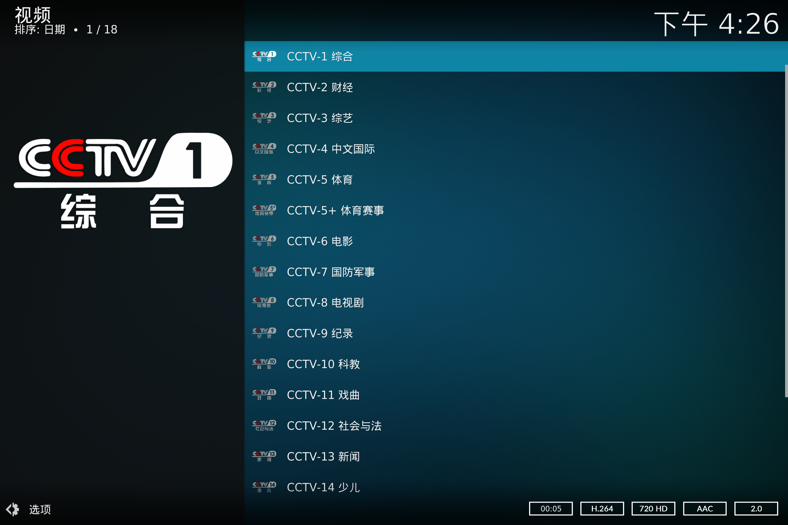

# plugin.video.cctv

 

在xbmc/kodi浏览cctv.com的电视节目、文章和电视直播，包含搜索同步历史和书签、保存副本。本插件适用于xbmc19及以上版本。

## 截屏

||  |
| --- | --- |
|插件首页，快速访问历史记录，书签和影视内容|片库，观看电影、电视剧、动画片和特别节目|
|||
|片库，观看电影、电视剧、动画片和特别节目|播放，支持播放列表视频快进|

## 许可证
**plugin.video.cctv**基于**MIT**许可证构建[LICENSE](LICENSE)