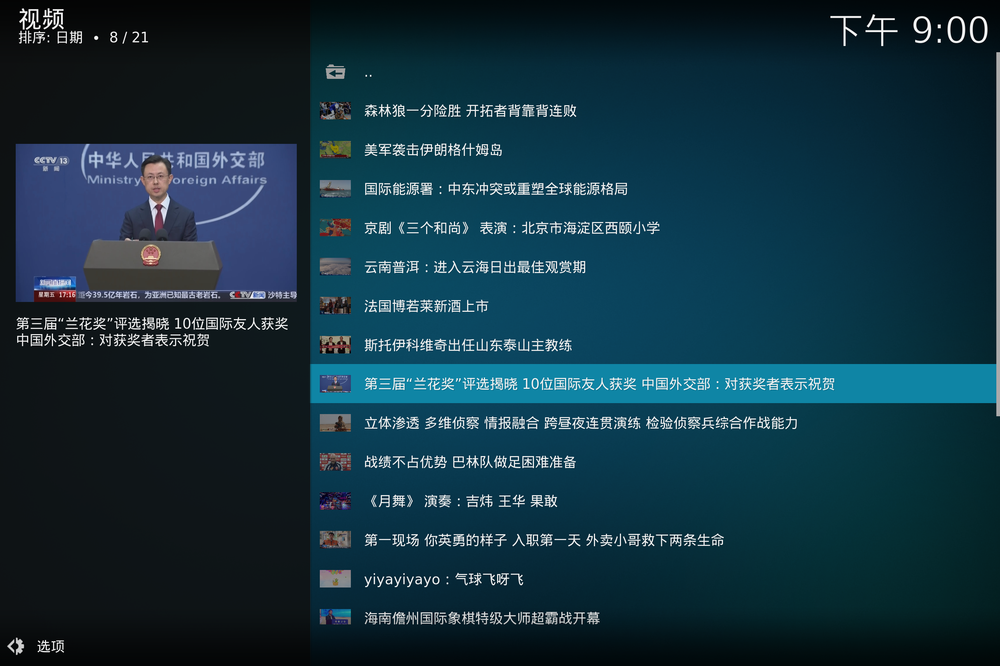
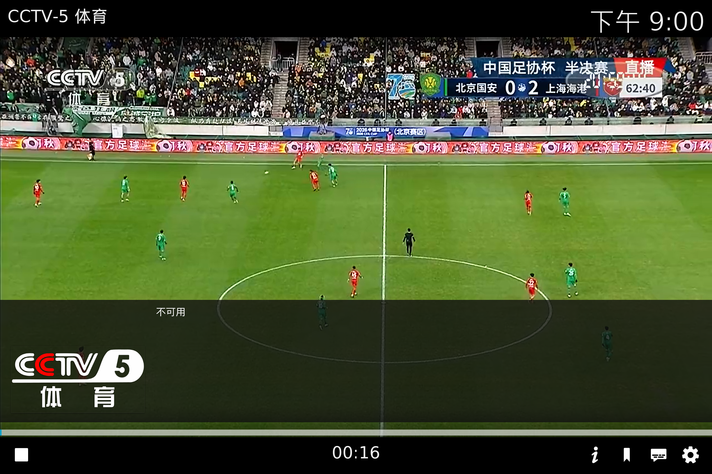
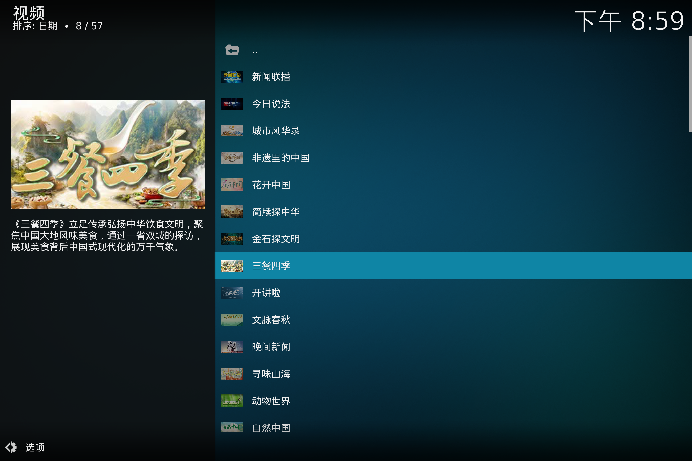

# plugin.video.cctv

 

在 Kodi 里浏览央视网（cctv.com）的电视节目、文章和电视直播。

**链接**

[央视网直播](https://tv.cctv.com/live/m/index.shtml)

[央视网视频](https://v.cctv.com/)

[央视网听音](https://tv.cctv.com/ty/m/index.shtml)

[央视网搜索](https://tv.cctv.com/search/m/index.shtml)

**Note**

本项目是第三方客户端，与央视网官方无关；仅读取公开页面与接口中提供的内容，不提供、不修改、不绕过任何受版权保护的媒体。所有节目、文章、图片的版权归中央广播电视总台及原权利人所有，请在合法范围内使用。

 A third-party Kodi addon that browses public cctv.com pages (home, news, videos, sports, match highlights, 4K zone, TV columns, live channels and search) inside Kodi's native interface, with long-press preview and download. It ships no media, does not circumvent DRM, and is not affiliated with CCTV. Licensed under MIT.

Copyright (c) 2026 netpious。
